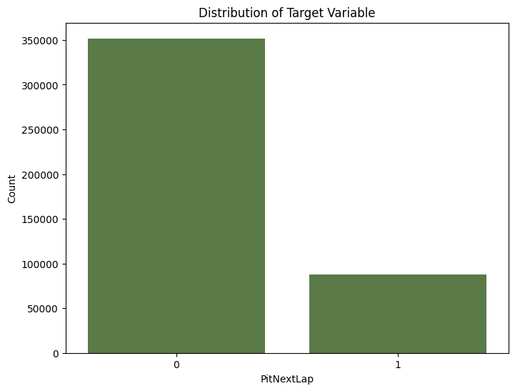
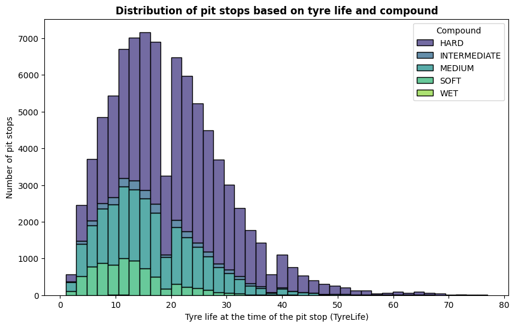
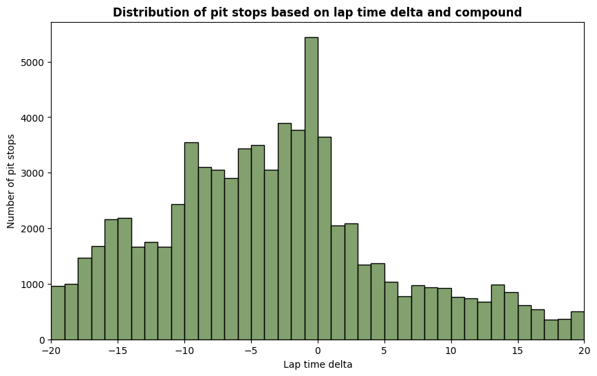
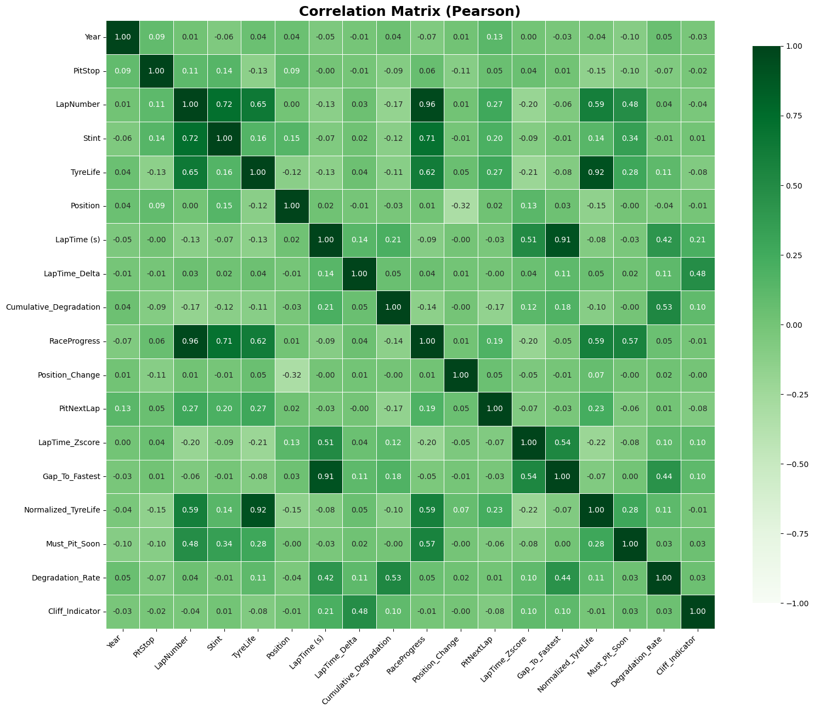
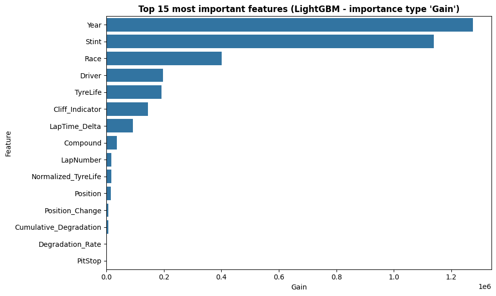
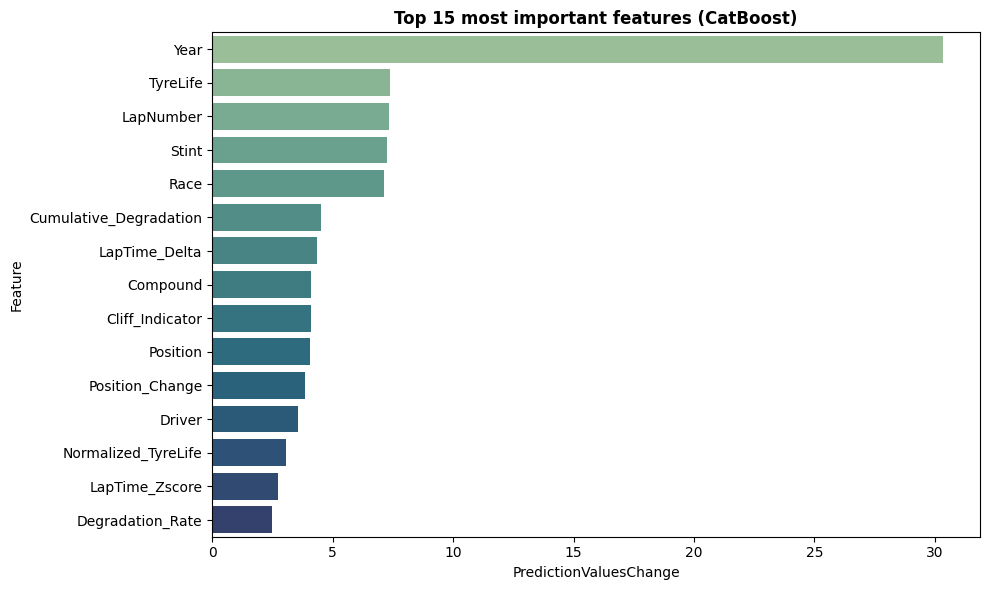
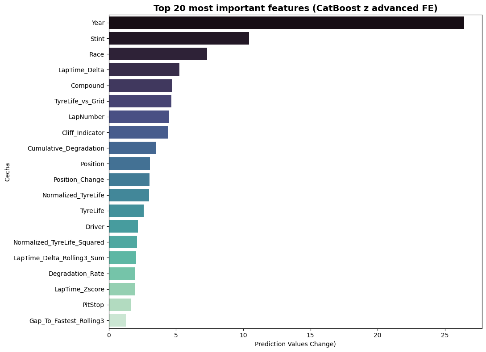

# Predicting_F1_Pit_Stops
This repository contains my solution for the Kaggle Predicting F1 Pit Stops competition

## Overview
In Formula 1, pit stops are far more than just a mandatory tire change - they are the defining strategic element of a Grand Prix. A brilliantly timed pit stop can completely upend the race order, allowing a driver to outsmart faster cars and secure an unexpected victory. Accurately predicting when a driver will pit requires understanding a complex web of race dynamics, tire physics, and split-second team strategy.

## Goal
The goal is binary classification whether a Formula 1 driver will pit on the next lap.

## Dataset
Dataset for this competition was generated synthetically inspired by the real-world data (F1 strategy data). Feature distributions are close to the original ones.

- Dataset was split by organizers to train and test sets. 
- Target variable: `PitNextLap`

## Key Challenges and Strategic Approach
Before starting coding I observed 2 potential challenges:
- **Track-Dependent Lap Times:** Raw lap times (LapTime (s)) are highly circuit-specific and cannot be directly compared across the dataset. For example, an 80-second lap might indicate a slow pace at Monaco but is physically impossible at the Red Bull Ring. To prevent the model from misinterpreting raw pace, this solution focuses on relative feature engineering.
- **Chronological Data Leakage:** Formula 1 race data is inherently sequential. If the dataset undergoes a random train/test split, it introduces a severe risk of data leakage. For instance, the model could theoretically use information from lap 19 in the training set to predict lap 18 of the same race in the test set. To build a robust model that learns genuine pit strategies rather than memorizing specific historical events, the cross-validation strategy relies on grouped splitting. 
**Edit:** An exploratory analysis of the dataset revealed a complete overlap in the `Race + Year` feature between the training and test sets (104 out of 104 races are shared). From a real-world Formula 1 forecasting perspective, this is a highly unrealistic split. In practice, predicting pit stops requires forecasting future events based entirely on past races. 


## Feature Engineering
To extract hidden strategic dependencies, a comprehensive set of relative features was engineered using a concatenated train and test dataset:
* **Normalized Lap Times:** Created `LapTime_Zscore` relative to race-year means and `Gap_To_Fastest` to capture the deficit to the leader on a given lap.
* **Tire Life Reconstruction:** Computed maximum tire life per compound per track (`Track_Compound_Max_Life`) to synthetically reconstruct the crucial `Normalized_TyreLife` feature dropped by organizers.
* **Degradation Metrics:** Engineered `Degradation_Rate` (cumulative degradation over tire life) and `Cliff_Indicator` (product of tire life and lap time delta) to flag critical grip loss.
* **Regulatory Constraints:** Introduced a binary flag `Must_Pit_Soon` for drivers exceeding 80% race progress who had not yet satisfied compound-switching rules.
*After aggregation, temporary columns and highly collinear base features were dropped.*

## Exploratory Data Analysis (EDA)
An initial exploratory data analysis revealed key strategic and technical patterns driving pit stop decisions:
* **Class Imbalance:** Pit stops represent a small fraction of all lap records, which required setting class weights (`scale_pos_weight`) during model training.

<figure align="center">
  
</figure>

* **Pit Windows:** The target distribution relative to `RaceProgress` and `Compound` highlights clear lap intervals where specific tire compounds reach their physical limits.

<figure align="center">
  
</figure>

* **The "In-lap Push" Phenomenon:** An analysis of lap time deltas (`LapTime_Delta`) uncovered an unexpected acceleration right before a pit stop (negative values). Drivers, freed from tire preservation, maximize energy deployment (ERS) on their in-lap.

<figure align="center">
  
</figure>

* **Collinearity:** Pearson correlation matrices helped identify highly collinear features, guiding the removal of redundant noise.

<figure align="center">
  
</figure>

## ML Modeling
### Baseline (LightGBM)
The first baseline model utilized a LightGBM Classifier (default hyperparameters). 
The pipeline was structured around a 5-fold Stratified K-Fold cross-validation, averaging Out-Of-Fold (OOF) probabilities. Feature importance evaluated via "Gain" confirmed the effectiveness of our engineered features, highlighting the dominant role of the year, stint number, and `Cliff_Indicator`. The baseline model achieved an OOF ROC AUC of ~0.915 and a public leaderboard score of ~0.918.

 Features importance:

<figure align="center">
  
</figure> 


### LightGBM OptunaTuned Model
 I used Optuna to tune LightGBM model. The optimized model achieved an improved score of 0.93026 on the public leaderboard.

 ### CatBoost OptunaTuned Model
 As in LightGBM I used Optuna to optimize hyperparameters od Catboost. I used Google Colab GPU to train Catboost models. The model achived even better result on kaggle public leaderboard: 0.94817.

  Features importance:

 <figure align="center">
  
</figure> 

### XGBoost OptunaTuned Model
To diversify the learning approach, an XGBoost model was introduced. Optimized with Optuna and trained using GPU acceleration, the model achieved a solid score of 0.94085 on the public leaderboard.

### Ensembling & Rank Blending
Since LightGBM, CatBoost, and XGBoost build trees and process categorical features differently, ensembling is a standard Kaggle technique to maximize the ROC AUC score. 
* **Probability Blending:** An initial attempt at a simple 50/50 average of LightGBM and CatBoost probabilities decreased the overall score.
* **Rank Blending:** To bypass the probability scaling issue, raw probabilities were converted into normalized ranks. A 3-Way Rank Blend was executed, heavily weighting the stronger models (50% CatBoost, 25% XGBoost, 25% LightGBM). This ensemble achieved 0.94541 on the leaderboard.
* **Conclusion:** The 3-Way Rank Blend ultimately underperformed compared to the CatBoost model. This indicates that CatBoost's native categorical encoding  is vastly superior for this specific dataset.


### CatBoost with Advanced Feature Engineering
In an attempt to break the 0.95 ROC AUC barrier, a set of advanced, domain-specific features was engineered to capture actual F1 racing strategy rather than just raw telemetry. These included:
- Grid Pressure: Comparing a driver's tire age to the average tire age of the rest of the grid on the same lap.
- Compound Death (Normalized TyreLife Squared): Exponentially amplifying tire wear to simulate the cliff edge of tire performance. (Carefully mapped using only training set history to prevent data leakage/covariate shift).
- Panic Indicator: An interaction feature combining sudden pace drops with position loss.
- Rolling Features: 3-lap rolling averages for gap to fastest and lap time delta.

Although Feature Importance analysis confirmed that the model highly valued these new strategic features (with TyreLife_vs_Grid breaking into the Top 5), the model achieved a score of 0.94714 on the public leaderboard.

 <figure align="center">
  
</figure> 

## Results
| Model | Kaggle Public LB ROC AUC |
| :--- | :--- |
| **LightGBM (Baseline)** | 0.91827 |
| **LightGBM (Tuned - Optuna)** | 0.93026 |
| **XGBoost (Tuned - Optuna)** | 0.94085 |
| **3-Way Rank Blend** | 0.94541 |
| **CatBoost (Advanced Feature Engineering)** | 0.94714 |
| **CatBoost (Tuned - Optuna)** | **0.94817** |


## Repo Structrue
```
Predicting_F1_Pit_Stops
 ┣ /figures                       
 ┣ Analysis_Feature_Eng.ipynb       # Datasets preparing and analysis
 ┣ Baseline_model.ipynb
 ┣ Cat_Boost.ipynb
 ┣ Cat_Boost_FE.ipynb
 ┣ XGBoost.ipynb
 ┣ Light_GBM.ipynb
 ┗  README.md
```
